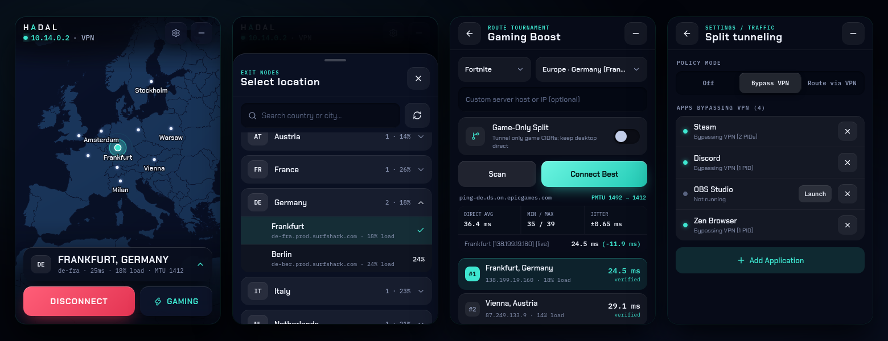

# Hadal VPN

A Linux-native, open-source WireGuard VPN client built for Surfshark accounts around a privileged Rust network daemon (`hadald`), a terminal controller (`hadal-cli`), and a tray-first Tauri v2 + SolidJS desktop popover (`hadal-gui`).



> **Unofficial Client:** Hadal VPN is an independent, community-developed open-source project. It is not affiliated with, endorsed by, or sponsored by Surfshark B.V.
>
> **Platform scope:** Linux only (`systemd`, kernel WireGuard, `nftables`, `rtnetlink`, `cgroupv2`).

## Architecture Overview

- **`hadal-core`**: Surfshark API auth (6-char Quick Pair code + automatic JWT refresh, no password handling), cluster discovery, Gaming Mode DoH/ICMP probing, XDG `.desktop` + `cgroupv2` split-tunnel helpers, and Unix-socket IPC schema.
- **`hadald`**: Privileged `systemd` daemon running as `root` and listening on `/run/hadald/hadald.sock` (`0660 root:network`). Manages kernel WireGuard (`hadal-wg`), policy routing (`table 51839`), `nftables` killswitch / IPv6 / DNS leak locks, `systemd-resolved` D-Bus DNS-over-TLS, `NETLINK_SOCK_DIAG` socket handoff, and `CONTROL_FWMARK` (`0xca6d`) control-plane probes.
- **`hadal-cli`**: Fast CLI for login, connection management, Gaming Mode scans, `cgroupv2` split tunneling, and diagnostics.
- **`hadal-gui`**: Compact `360×540` tray-resident popover (`StatusNotifierItem` via `ksni`) with optional Hyprland Lua snapping (`contrib/hyprland-hadal.lua`).

See [ARCHITECTURE.md](ARCHITECTURE.md) and [DESIGN.md](DESIGN.md) for deep-dive technical and UI documentation.

---

## Prerequisites

### Runtime Requirements
- Linux kernel with WireGuard (`CONFIG_WIREGUARD`) and `cgroupv2` unified hierarchy
- `systemd` and `systemd-resolved` (or `resolv.conf` fallback via `--dns-mode resolv-conf`)
- `nftables` (`nft` binary) and `iputils` (`ping` with `-M do` and `-m` fwmark support)
- For `hadal-gui`: `webkit2gtk-4.1`, `gtk3`, `libsoup3`, and a `StatusNotifierItem` system tray host (e.g. Waybar, Quickshell/DMS, KDE, GNOME AppIndicator)

### Build Dependencies
- **Rust toolchain** (`cargo`, `rustc`)
- **Bun** (for the SolidJS frontend in `crates/hadal-gui`)
- System dev packages:
  - **Arch / CachyOS:** `base-devel pkgconf webkit2gtk-4.1 gtk3 libsoup3 openssl nftables iputils`
  - **Debian / Ubuntu (22.04+):** `build-essential pkg-config libwebkit2gtk-4.1-dev libgtk-3-dev libsoup-3.0-dev libssl-dev nftables iputils-ping`
  - **Fedora:** `gcc pkgconf webkit2gtk4.1-devel gtk3-devel libsoup3-devel openssl-devel nftables iputils`

---

## Install Prebuilt Release (Linux x86_64)

Download the latest release artifact from **GitHub Releases** (`soulis-1256/hadal-vpn`):

- **Debian / Ubuntu:** `sudo apt install ./hadal-vpn_*_amd64.deb`
- **Fedora / RHEL:** `sudo dnf install ./hadal-vpn-*.x86_64.rpm`
- **Arch / CachyOS:** `sudo pacman -U ./hadal-vpn-*.pkg.tar.zst`
- **Any systemd distro (release installer):**
  ```bash
  # Uses `gh release download` when authenticated (works for private repos), or curl for public repos:
  bash scripts/install.sh --from-release
  ```

After installing a `.deb`/`.rpm`/`.pkg.tar.zst` package, add your user to the `network` group (re-login once) and enable the tray service:

```bash
sudo usermod -aG network "$USER"
systemctl --user enable --now hadal-gui.service
```

---

## Build & Install from Source

1. One-command build, install, and service restart:

```bash
./scripts/install.sh              # builds frontend + release binaries, installs, restarts hadald & hadal-gui
./scripts/install.sh --reconnect  # same, and reconnects to your previous VPN node after hadald restarts
./scripts/install.sh --ui-only    # rebuild & restart only hadal-gui + hadal-cli (keeps VPN connected)
```

2. Fast local development without restarting `hadald`:

```bash
./scripts/dev.sh gui              # runs `bun run tauri dev` with hot-reload against the live hadald
./scripts/dev.sh cli status       # runs `cargo run -p hadal-cli` against the live hadald
```

3. *(Optional)* Hyprland `0.55+` / `0.57+` popover rules:
`hadal-gui` registers its floating/borderless rules automatically via `hyprctl eval` on launch. You can also load [contrib/hyprland-hadal.lua](contrib/hyprland-hadal.lua) in your Hyprland Lua config.

---

## Quick Usage

### CLI (`hadal-cli`)

```bash
# Authenticate (6-character Quick Pair code via Surfshark web/app; no password stored)
hadal-cli code

# Connect / inspect status / disconnect
hadal-cli connect --server de-fra
hadal-cli status
hadal-cli disconnect                # add --keep-killswitch to stay fail-closed

# Gaming Mode: probe DoH pools & WAN PMTU, then connect to best physical route
hadal-cli gaming --game fortnite --region eu-de --connect
hadal-cli gaming --game fortnite --region eu-de --connect --game-only

# Layer-3 cgroupv2 split tunneling
hadal-cli split mode bypass         # or only-vpn / off
hadal-cli split launch discord
hadal-cli split move steam
hadal-cli split status
```

### Desktop Tray App (`hadal-gui`)
Launch `hadal-gui` from your app launcher or terminal (`Escape` or `-` minimizes to the tray).

---

## Testing

```bash
# Tier 1: Rust unit & DI tests + unprivileged nftables syntax validation (`unshare -Urn`)
cargo test --workspace --exclude hadald
cargo test -p hadald --lib

# Frontend typecheck & Vitest suite
cd crates/hadal-gui && bun run typecheck && bun run test

# Tier 2: Full kernel netns + veth + WireGuard + AF_PACKET leak & split-tunnel E2E suite
cargo test -p hadald --test netns_e2e -- --nocapture
```

---

## License

Licensed under the [GNU General Public License v3.0 or later](LICENSE) (`GPL-3.0-or-later`).
